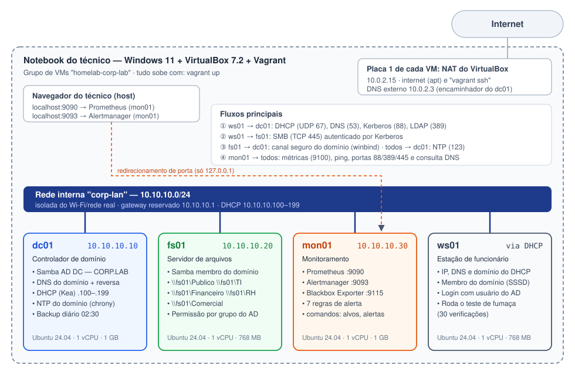
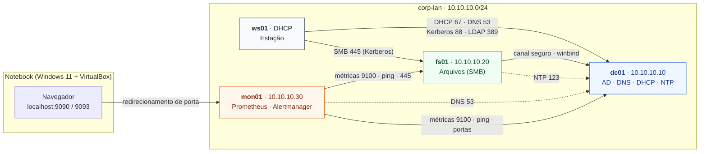

# 02 — Diagrama de rede

## Visão física e lógica



Fonte editável: [`img/diagrama-rede.svg`](img/diagrama-rede.svg) (SVG em texto, versionado junto com o código).

## Dependências entre os serviços

O diagrama abaixo é gerado pelo próprio GitHub a partir do texto (Mermaid). Ele responde à pergunta mais importante na hora de um incidente: **"se isso cair, o que mais para?"**



### Leitura de impacto

| Se cair… | Para de funcionar | Continua funcionando |
|---|---|---|
| **dc01** | Login novo, DHCP (estações novas ficam sem IP), nomes `corp.lab`, acesso novo a pastas (o Kerberos não emite ticket) | Quem já tem ticket Kerberos válido (até 10 h) continua com pastas abertas; IPs já concedidos valem até o fim da concessão (8 h) |
| **fs01** | Todas as pastas compartilhadas | Login, DHCP, DNS |
| **mon01** | Só a visibilidade: ninguém é avisado de nada | Todos os serviços da empresa |
| **ws01** | Só aquela estação | Todo o resto |

> O dc01 é o **ponto único de falha** do ambiente. Num ambiente real, o próximo passo seria um segundo controlador de domínio (dc02) replicando o AD e o DNS, e o DHCP em modo de alta disponibilidade. Ver [03 — Decisões](03-decisoes-de-arquitetura.md#d7--um-único-controlador-de-domínio).

## Por que duas placas de rede em cada VM?

```
            ┌──────────── placa 1: NAT do VirtualBox (10.0.2.15) ──► internet / apt / vagrant ssh
 cada VM ───┤
            └──────────── placa 2: rede interna "corp-lan" (10.10.10.x) ──► rede da empresa
```

- A **rede interna** do VirtualBox é um "switch virtual" que só as VMs enxergam. Isso deixa o DHCP do dc01 trabalhar **sem risco de entregar IP para a rede real** (Wi-Fi de casa ou da empresa) — um DHCP "fujão" numa rede real derruba a rede de todo mundo.
- A **placa NAT** é obrigatória para o Vagrant gerenciar a VM e dá internet para baixar pacotes. A rota padrão continua por ela; por isso a ws01 pega **IP, DNS e domínio** do DHCP do dc01, mas **não** a rota (`use-routes: false` no netplan).
